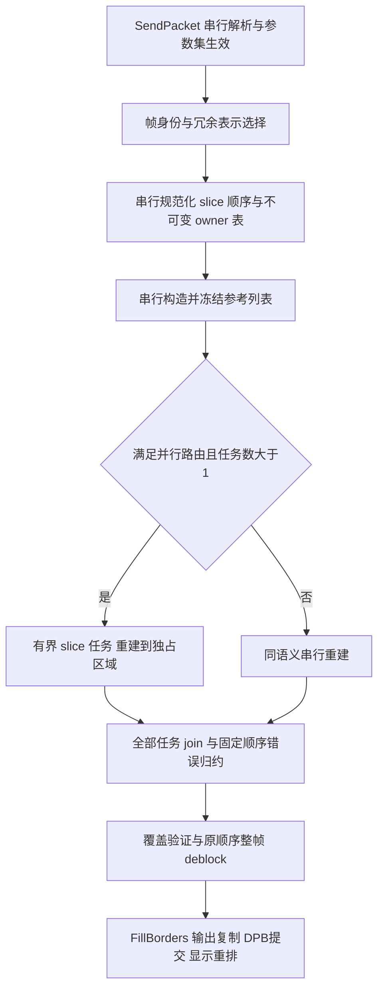

# 06：解码器 slice 级并行

对应 K19，依赖 K16/K17 的执行状态拆分和内存归属。首个目标不是“并行所有 H.264 工具”，而是在保留全部现有可解语义的前提下，为可证明独立的常规 slice 开启真正并行。优化路由之外仍使用同一串行实现，不新增媒体拒绝。

## 1. 接入点与阶段划分

当前 `SendPacket` 按码流顺序解析 SPS/PPS 和分区关联；`decodeFrame` 推进 DPB/POC；`reconstructRepresentations` 选择冗余表示；`reconstructRepresentation` 负责一张表示的重建与滤波。并行主要接入最后一层，而不是包扫描层。

图中各提交阶段保持当前错误处理：BeginFrame/POC在重建前已推进，失败由 `d.fail` 清理并等待IDR；不将本次优化顺带改成另一种事务模型。

## 2. K19a：先做串行隔离重构

目标文件：`decoder/frame.go`、`redundant.go`、`neighbors.go`、`cabac_slice.go`、`cabac_*`、`fmo.go`、`internal/motion/mv.go`；新增 `slice_state.go`/`slice_parallel.go` 按职责拆分。共享文件由集成负责人或单一任务owner修改。

### 2.1 数据分层

- 帧只读描述：尺寸、位深、scaling、SPS/PPS快照、POC、已经冻结的参考列表。
- 帧可分区存储：像素、decoded、info、NZ、dcCoded、MVD、MV、referenceIDs、directBlocks；每个MB只属于一个owner。
- slice私有执行：reader、CABAC engine/context、QP/lastDelta、component、activeMB、临时residual/MC/变换scratch。
- 场相关pic/parity/POC游标先保留串行，但结构拆分时不能破坏MBAFF原逻辑。

`frameState` 浅拷贝不是完整方案：`fullResidual`、Motion Grid描述符等内部指针仍会共享。共同444要求每个活跃任务拥有自己的 `*[2]planeResidual`，不能为了避开冲突只对420开启并行后宣称六格式完成。

### 2.2 不可变 owner-first

1. `prepareSliceOrder` / `assignSliceOwnership` 在派发前完成，确定每个物理MB的slice owner；本帧任务期间不变。
2. 不以worker会重写的 `info[addr].sliceID` 充当跨任务共享的owner判断来源。
3. 所有预测、nC、CABAC CBF/skip/MVD、MVP、direct邻域访问先检查坐标及owner；只有同owner才读decoded/info/NZ/MV等可变数组。
4. 当前 `neighborAvailable` 会先读decoded再判断身份，必须改顺序。即使跨slice结果最终被丢弃，读另一个worker正在写的bool仍是race。
5. `motion.Grid` 的sliceStart/mappedOwners/mappedSlice是描述符状态。每个任务有独立描述符，可共享底层不相交元素，不能并发BeginSlice同一个Grid。
6. 普通 `Available` 只判断 `mb>=sliceStart`、没有slice上界。并行时右上邻居可能已经由后续slice写好，产生与串行不同的可用性。推荐对连续slice也使用不可变owners约束，在读valid之前过滤；不要仅复制Grid描述符后保留旧判定。
7. 帧后滤波/DPB保留的Grid恢复成完整帧描述，不携带任务临时owner游标；借用owner表生命周期明确。

K19a先在Threads=1跑原有所有格式与高级工具，证明拆分本身不改结果，再单独提交worker调度。

## 3. K19b：第一批并行路由

全部条件满足时并行：

- 渐进帧；普通单slice group；primary、无冗余多表示竞争；非data partition；非SP/SI；非separate-colour-plane。
- 常规I/P/B，CAVLC或CABAC。
- 420/422/共同444，8/10-bit，至少两个可独立slice。
- 已建立完整owner表、参考列表和全部task-local scratch。

每个任务解码**一个完整slice**，slice内部MB保持现有扫描/熵顺序。不能随意按行、按MB或按CABAC字节切分。片首/片尾可以在行中，不能只对“整行slice”正确。

slice任务只写owner区域，并使用只读参考帧。CABAC上下文、bit reader和lastDelta独享；不允许多个worker从同一可变reader读位置。

Threads=1直接串行调用同一slice执行函数，不走创建worker的旁路；Threads>1按 `min(有效并行预算,slice数量)` 调度。调用goroutine可以参与计算，worker总数不超预算。

## 4. K19c：高级工具兼容路由

以下组合初始明确串行执行，不改变支持状态或返回新Unsupported：

| 组合 | 必须保持的既有行为 |
|---|---|
| FMO 0–6、ASO | 先规范化顺序、NextMbAddress和非连续owner；组内覆盖/邻域隔离不变 |
| A/B/C数据分区 | 按slice_id关联A/B/C、独立残差消费与尾位检查；不能半个分区提前完成 |
| 冗余表示 | 每个cnt独立重建；低cnt失败后只有全部任务结束才能释放并尝试下一完整表示；不跨表示拼图 |
| MBAFF/TFF/BFF | pair扫描、场参考、帧场邻域、420相位和逐对滤波不变 |
| SP/SI | 系数域切换重建、QP/QS与slice内反馈顺序不变 |
| 独立色平面 | colour_plane_id覆盖与各分量元数据隔离、只提交一次图片 |

未来扩展并行覆盖需要单独证明和任务，不把这些串行路由当永久“不支持”。测试要在Threads>1配置下输入它们，证明确实仍可解且结果不变；报告写“串行兼容”，不能冒充并行速度收益。

PAFF等M7原Unsupported保持原错误分类；不能将合法高级工具因调度条件不满足误分成无效码流。

## 5. K19d：有界调度与错误

建议采用单次公开调用内的fork/join：惰性启动本批有限worker，任务/结果slot预分配并复用，调用结束前全部退出。不能让 `SendPacket` 返回后任务继续使用Packet.Data/RBSP。若后续测量需要常驻worker，必须单独补齐Close/Reset/取消/join证明，不能在同一提交中悄悄引入。

- 不为每slice创建goroutine，也不为每slice复制frameState的整帧数组。
- 结果按规范化slice序号存入固定槽，不按完成顺序append。
- 错误按串行slice顺序选择。多个slice损坏时，最早完成的错误不一定是应返回的错误。
- 可以在确认不会影响前序错误时减少后续派发；若实现复杂，先完成本批全部任务再归约，正确性优先。
- 错误cleanup只发生于全部workerjoin后，不能首错即Release工作图像。
- `d.fail` 当前不普遍丢弃已经在out中的历史成功帧；本次失败不新增半帧输出，也不误删先前成功输出。
- 参考帧只读期间不得执行DPB淘汰/Reset/MMCO；公共调用非并发安全不代表内部worker可同时触发这些操作。

## 6. K19e：滤波屏障与单一提交

1. 全部重建和所有权覆盖检查成功。
2. 主线程恢复帧视图和完整Grid上下文。
3. 按旧顺序执行整帧去块；IDC0/1/2、跨slice滤波与MBAFF特殊分段保持。
4. FillBorders一次；只对完整原图操作，不对FieldView单独扩边。
5. 输出拷贝、原生LE序列化；成功参考转交DPB，非参考工作图归池。
6. 保持MMCO/POC/显示重排的原提交顺序，单张图片只提交一次。

本阶段不并行deblock，也不在slice重建完成时立即滤波自己的边界：跨slice边缘会读写另一个任务区域，且滤波顺序影响结果。

## 7. 必须新增/扩展的测试

### 7.1 可并行路由

- Threads=1/2/0/远大于slice数；六格式×双熵×I/P/B；所有有效像素、帧元数据、PTS/Duration/KeyFrame和显示顺序相等。
- slice切在行中，右上邻块属于后续slice，强制不同调度顺序；不得依赖sleep碰运气，用测试同步钩子控制任务到达阶段。
- 共同444反复切component并产生非零残差，发现共享fullResidual污染。
- 不同slice的QP、权重、参考重排；B temporal/direct、MMCO、长期参考；8×8/非平坦矩阵。
- deblock IDC0/1/2及跨slice非零bS；验证整帧过滤结果。
- 双slice同时截断、重复首MB、缺失覆盖、越界skip_run；固定错误分类和优先次序；新IDR恢复。

### 7.2 串行兼容与资源

在Threads>1下复用FMO、partition、redundant、SP/SI、MBAFF、separate-plane原解析/Oracle用例；不要仅验证调度判断函数返回false。

验证SPS/位深/格式切换、Reset/Close/错误路径pool借出数回到预期；没有仍在写旧图的worker；scratch随workers增长而不是随sliceCount复制整帧。

### 7.3 现有保护网

`decoder/decoder_test.go` 的生命周期与覆盖用例，`fmo_normative_test.go` 的跨slice/MVP所有权用例，`data_partition_normative_test.go`、`redundant_normative_test.go`、`mbaff_normative_test.go`、`high444_oracle_test.go`、全55条原生哈希与27份High10投影。测试名称开工时按源码确认，不能把未存在的新测试写成已通过证据。

最后做定向race和完整race；SIMD汇编内存不受race插桩，仍需要owner证明及强制Generic运行的并行race。完整命令见 [09](09_validation.md)。

## 8. 本轮收益准入决定

本节记录早期 K19 暂缓决定，不是当前限制。后续 C09 已交付整行 slice 并行；行内切分仍走串行，实际范围及测量见 [C09](../gates/c09_slice_parallel.md)。

K15–K18串行内存切片交付后，本轮暂不实现K19 worker。实际 `h264probe` 确认现有1080p冷基准三帧分别只有一个slice，slice并行对此输入没有可分任务；320×240多slice语料六帧各两个slice，只能证明存在候选负载，不能替代1080p/High代表性多slice的阶段占比与吞吐证据。原始输出保留于 `tmp/m8-k15-k20/k19-{1080p,multislice}-probe.json`。

这不是宣布多slice并行不可行或没有收益，也不删除原K19范围。当前仍缺owner-first全链路、任务私有Grid/共同444执行状态和代表性多slice基准；不为没有端点收益证据的调度投入提前建设通用执行器。后续以真实大尺寸多slice负载及重建阶段占比重新准入，按本章完整正确性矩阵实施。当前Threads>1仍返回原ErrUnsupported，不能把串行兼容或配置放行冒充并行实现完成。
